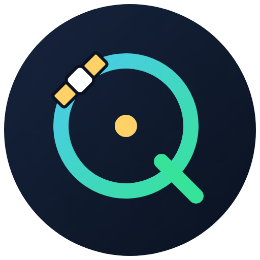

  

<h1 align="center">Orbiq</h1>

**Műholdkövető program Doppler-korrekcióval, SDR++ vezérléssel** (Windows, grafikus felület, parancssor nélkül).

*English: see [README.md](README.md).*

## Telepítés (Windows)
Az Orbiq Python programként fut, külön telepítő nincs. Az alábbi lépésekkel pár perc alatt elindítható.

### 1. lépés – a Python telepítése (egyszer kell)
1. Nyisd meg a [python.org/downloads/windows](https://www.python.org/downloads/windows/) oldalt.
2. Keresd meg a **Python 3.13** legújabb kiadását, és töltsd le a **„Windows installer (64-bit)”** fájlt. (Ne az „embeddable package”-et és ne a „Windows installer (32-bit)”-et.)
3. Indítsd el a letöltött fájlt. **Az első képernyőn, még a telepítés előtt:**
   - **Pipáld be alul az „Add python.exe to PATH” dobozt.** Ez a legfontosabb! Enélkül a START.bat nem találja a Pythont.
   - Ha van ott „Use admin privileges when installing py.exe” jelölőnégyzet, az maradhat az alapértelmezett állapotában.
   - Utána kattints az **„Install Now”** gombra (a „Customize installation” nem kell).
4. Ha a Windows rákérdez („Engedélyezed, hogy az alkalmazás módosításokat hajtson végre?”), válaszolj **Igen**-nel.
5. A végén, a „Setup was successful” képernyőn kattints a **Close** gombra. (Ha látsz „Disable path length limit” lehetőséget, azt is bepipálhatod, de nem kötelező.)

### 2. lépés – az Orbiq letöltése
1. A GitHub-oldalon kattints a zöld **Code** gombra, majd a **Download ZIP** pontra.
2. Csomagold ki a letöltött ZIP-et egy saját mappába, például `C:\Radio\Orbiq`. A kicsomagolás **kötelező**: ne a ZIP-ből, hanem a kicsomagolt mappából indítsd.
3. Az adataid (műholdlista, beállítások) a program mellé, a `data` mappába mentődnek.

### 3. lépés – az indítás
1. Nyisd meg a kicsomagolt mappát, és kattints duplán a **`START.bat`** fájlra.
2. Az első indításnál egy fekete ablak jelenik meg, és letölti a szükséges csomagokat. Ehhez internet kell, és eltarthat egy-két percig. A sorok közt látható sárga *WARNING* feliratok általában ártalmatlanok, csak várj.
3. Ezután megnyílik az Orbiq ablaka. A következő indításoktól már gyorsan indul.
4. Ha a START.bat azt írja, hogy a Python nincs telepítve, pedig telepítetted, akkor vagy kimaradt az **Add python.exe to PATH** pipa (futtasd újra a Python-telepítőt, válaszd a **Modify**, majd a *Add Python to environment variables* opciót), vagy a telepítés után nem zártad be és nyitottad meg újra a START.bat-ot.

A program későbbi frissítéséhez nem kell újra letöltened a ZIP-et: a **Beállítások → Frissítés** részen a *Frissítés keresése* gombbal egy lépésben frissíthetsz.

### Utána
1. **Beállítások** fül: írd be az állomásod szélesség/hosszúság koordinátáját (tizedfokban, pl. `47.123456` / `17.123456`), a **📍** gombbal ellenőrizheted Google Térképen, majd **Alkalmaz és mentés**.
2. SDR++-ban: *Module Manager* → `rigctl_server` hozzáadása → port `4532` → *Start*. A Beállítások fülön a **Kapcsolat tesztelése** gombbal ellenőrizheted.
3. **Követés** fül → **Műhold hozzáadása**: NORAD ID (pl. `25544`), Keresés, válaszd ki a frekvenciát, Mentés.

Ha valaki saját, önálló `.exe`-t szeretne, a PyInstaller segítségével magának lefordíthatja a forrásból.

## Az adataid és a biztonsági mentés
Minden adatod (műholdlista, frekvenciák, állomás helyzete, ütemezés, TLE-k) a program mellett, a **`data`** mappában
van (`data\config.json`). A mappa másolásával az egészet költöztetheted vagy elmentheted. A program biztonságosan ír
(ideiglenes fájl + az előző ép példány megőrzése), induláskor és 6 óránként automatikus mentést készít (a legutolsó 40
marad meg a `data\backups` mappában), és ha a beállításfájl valaha megsérül (például Windows-összeomlás után), magától
visszaáll az utolsó ép mentésre. A **Beállítások → Adatok és biztonsági mentés** részen van kézi mentés, mentés fájlba
és visszaállítás gomb. A régebbi változat adatait (`%APPDATA%\Orbiq`) az első indításkor automatikusan átveszi.

## Kapcsolat
- Telegram-csoport: **[Orbiq Sat Tracker](https://t.me/orbiq_tracker)** – kérdések, hibák, ötletek
- E-mail: **orbiq_tracker@icloud.com**

Hibánál kérlek írd meg az Orbiq verzióját (az ablak címsorában látszik), és csatolj képernyőképet.

## Licenc
MIT – lásd a [LICENSE](LICENSE) fájlt. Ez egy béta verzió; a visszajelzéseket nagyon szívesen várom.
